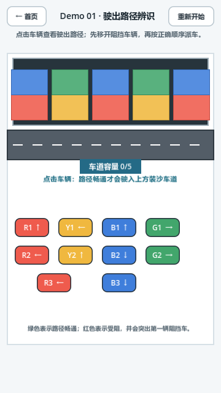
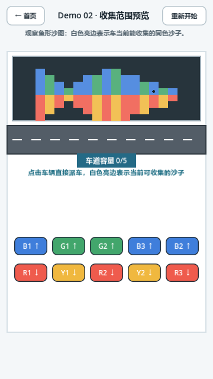
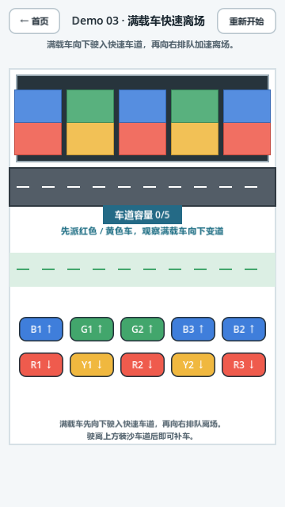
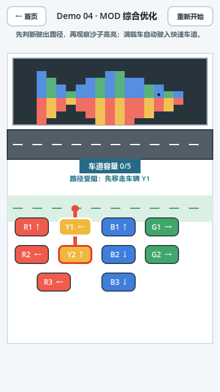
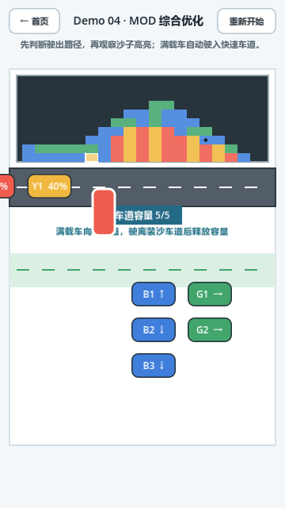
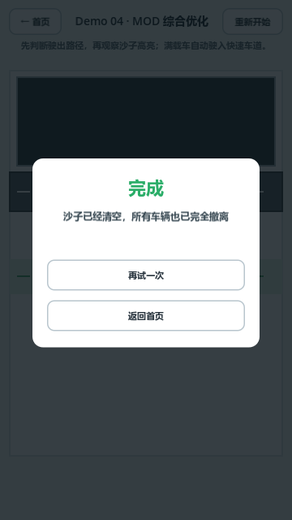

# 王文晋 · 游戏策划作品展示

## SandBus｜公交车关卡体验优化原型

**从“看不清、判断难、等待久”三个体验问题出发，制作三个专项可玩关卡和一个综合关卡。**

Godot 4.7.2 · 竖屏 · 鼠标 / 触屏 · 简洁几何美术

本仓库仅公开作品展示材料；完整源工程保留在私有仓库。可玩工程和安装包可在面试时单独提供。此页面不是在线游戏，公开视频用于快速了解设计。

### 快速查看

- [下载新版演示视频（MP4，约 32 秒 / 0.6 MB）](https://github.com/con3eited-dot/sandbus-showcase/raw/refs/heads/main/media/sandbus-demo-preview.mp4)
- [查看验证结果与边界](docs/validation.md)
- [下载全部公开展示材料（ZIP，不含源代码）](https://github.com/con3eited-dot/sandbus-showcase/archive/refs/heads/main.zip)

新版视频由 Godot 桌面引擎固定 30 帧输出，包含四关初始画面、综合关实际收集与撤离后的通关、死锁失败和新开局恢复。派车由自动脚本驱动，不是编辑器窗口人工操作录像；不手动清沙或跳过离场。

### 设计问题与方案

| 体验问题 | 原型中的优化 | 希望验证的体验 |
| --- | --- | --- |
| 车辆箭头和遮挡关系不容易判断 | 显示完整驶出路径；受阻为红色并提示第一辆阻挡车，摇晃后回到原位 | 玩家能理解“为什么这辆车现在不能出发” |
| 不清楚哪些沙子能被车辆收集 | 实时高亮范围内、已露出的同色沙；用鱼形图案展示下层消耗后的下落和重堆积 | 玩家能看见收集对象，并理解沙面变化 |
| 满载车辆尚未撤离时仍占用容量 | 满载后向下进入快速车道，以四倍车速有序撤离，驶离装沙车道后释放容量 | 缩短满载后的无操作等待，同时保持车辆可读性 |

这些是设计假设和功能验证，不是已经证明的留存、流失率或满意度提升结论。

### 三个专项关卡

<table>
<tr><th>Demo 01 · 路径与阻挡</th><th>Demo 02 · 收集范围</th><th>Demo 03 · 快速离场</th></tr>
<tr>
<td></td>
<td></td>
<td></td>
</tr>
</table>

每个专项关卡对应一个测试方向；Demo 01、02 不启用快速离场，避免混淆专项测试。Demo 04 · MOD 综合三项优化。

### 综合关卡：反馈与结算

<table>
<tr><th>受阻反馈</th><th>高亮 / 下落 / 变道</th><th>实际清沙与撤离后的通关</th></tr>
<tr>
<td></td>
<td></td>
<td></td>
</tr>
</table>

[失败画面](media/mod-fail.png) · [新开局恢复画面](media/mod-restart.png) · [四关选择首页](media/menu.png)

### 玩法

车辆编号使用颜色英文首字母：R = Red（红色）、Y = Yellow（黄色）、B = Blue（蓝色）、G = Green（绿色），数字区分同色车辆。

点击下方车辆，车辆沿箭头方向驶出。路径上的其他车辆会阻挡，即使同色也不能穿过。可驶出的车进入上方装沙车道，车道最多容纳五辆车；车辆向右排队移动，自动收集附近已露出的同色沙。

沙子装完且全部车辆撤离即胜利。五辆车均无法继续收集时会失败。可重新开始或返回首页。综合关应先派红黄车，容量腾出后根据露出的沙子颜色补蓝绿车，而非盲目填满车道。

### 验证与实现取舍

- 四关自动胜负、场景加载、沙量与车容量匹配检查已通过。
- 沙子重力、边界、无重叠与各色沙量守恒检查已通过。
- 最新桌面有渲染运行，综合关真实时间推进，完成通关、死锁失败和新开局恢复；没有强制清沙或跳过车辆离场。
- 已有 Android 模拟器操作验证；没有实体手机验证。桌面截图由自动派车产生，不等同于编辑器窗口人工试玩录像。

原型用粗格子重力而非细粒子物理，用简单图形而非美术复刻，把制作成本集中在规则可读性和完整可玩流程上。收集半径是原型参数，不是原游戏实测值。

### 本人工作与工具

关卡体验问题梳理、优化方向选择、原型需求定义及试玩反馈迭代；使用 Godot，并借助 AI 辅助实现与测试。重点展示设计推理和迭代过程，不将 AI 辅助开发包装为独立完成的全部程序工作。

本页只包含自制原型展示，不公开原始笔试题目、数据、源代码、内部日志或工具链。公开材料用于招聘作品查看，不附带开源代码授权。
